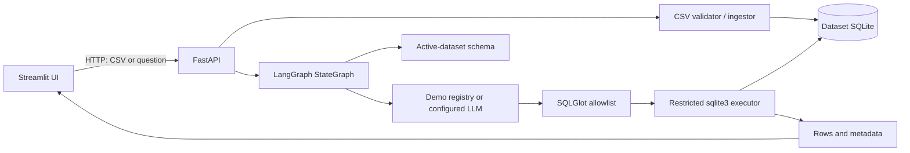

# SQLInsights

SQLInsights lets you ask questions about CSV data in plain English. It proposes SQLite through a
bounded LangGraph workflow, checks every query against a deterministic read-only policy, and shows
the rows returned by the database in a table or chart.

The project is deliberately local and small: it helps a non-SQL user explore bounded CSV datasets
without giving a language model direct database access. A no-key demo is included for eight exact
questions over synthetic retail data.

```bash
docker compose up --build
# open http://127.0.0.1:8501
```

This is a single-user, localhost-only MVP without authentication. It is **not suitable for public
or multi-user deployment**.

## Features and non-features

- Reproducible synthetic retail dataset with customers, products, and orders.
- Dataset creation, selection, deletion, CSV upload, schema inspection, and previews.
- UTF-8 CSV validation with file, table, row, column, cell, and identifier limits.
- Typed LangGraph states for schema loading, SQL generation, validation, execution, and response.
- Honest no-key demo mode for exactly eight predefined Retail Demo questions.
- Optional OpenAI-backed mode for novel questions when a key and model are configured.
- Reviewable canonical SQL, actual result rows, status, latency, attempts, and warnings.
- Deterministic bar, line, scatter, and pie charts derived only from returned rows.
- SQLGlot AST policy plus a separate restricted, read-only SQLite executor.
- Offline tests, a 25-case deterministic evaluation, CI configuration, and local Compose files.

SQLInsights does not support external databases, arbitrary user SQL, generated Python, shell
commands, web tools, authentication, multi-user tenancy, or public deployment.

## Architecture and trust boundary



The provider receives the user's question and only the selected dataset's table/column metadata.
It never receives a database connection or arbitrary tool access. Model output is untrusted and
must pass the same deterministic validator and executor used by demo mode.

The graph follows `load_schema → generate_sql → validate_sql → execute_sql → format_response`.
One regeneration is allowed for supported parse/execution errors; policy denials, timeouts,
credential errors, and access denials do not loop. The graph has an explicit recursion limit.

## SQL security design

1. SQLGlot parses exactly one SQLite `SELECT`, rejects compound/mutating/DDL/PRAGMA/ATTACH
   statements, internal or cross-database tables, unknown functions, and tables outside the active
   dataset, then serializes the approved AST.
2. The executor revalidates SQL and opens a fresh app-owned SQLite URI with `mode=ro`.
3. `PRAGMA query_only=ON`, disabled extension loading, and a deny-by-default SQLite authorizer
   independently block writes, schema changes, unapproved functions, and table escape.
4. A progress-handler deadline, SQL-length limit, short lock timeout, and 200-row default cap bound
   resource use and report truncation truthfully.
5. Uploads are limited to 5 MiB, three tables per dataset, 40 columns, 50,000 rows, and 20,000
   characters per cell. App-owned dataset paths cannot be supplied by clients.

These layers reduce risk but are not a general database sandbox. Keep both services on loopback.

## Quick start without an API key

Python 3.12 is required. With a global `uv` installation:

```bash
uv sync --locked
cp .env.example .env
uv run uvicorn backend.app.main:app --host 127.0.0.1 --port 8000
```

In a second terminal:

```bash
API_BASE_URL=http://127.0.0.1:8000 \
  uv run streamlit run frontend/app.py \
  --server.address 127.0.0.1 --server.port 8501
```

If your shell says `uv: command not found`, bootstrap a temporary project-local runner:

```bash
python3.12 -m venv /tmp/sqlinsights-uv
/tmp/sqlinsights-uv/bin/pip install uv==0.9.6
/tmp/sqlinsights-uv/bin/uv sync --locked --python python3.12
```

Then use `.venv/bin/uvicorn`, `.venv/bin/streamlit`, `.venv/bin/pytest`, and
`.venv/bin/ruff` in place of `uv run ...`. Open <http://127.0.0.1:8501>; API docs are at
<http://127.0.0.1:8000/docs>.

## Environment

Copy `.env.example`; never commit the resulting `.env`.

| Variable | Purpose | Default/example |
|---|---|---|
| `AI_MODE` | `demo` or `llm` | `demo` |
| `OPENAI_API_KEY` | Provider credential, backend only | blank |
| `OPENAI_MODEL` | Structured-output-capable configured model | blank |
| `OPENAI_TIMEOUT_SECONDS` | Provider deadline | `30` |
| `DATA_DIR` | App-owned local storage | `./data` |
| `MAX_UPLOAD_MB` | Per-file upload bound | `5` |
| `MAX_RESULT_ROWS` | Returned-row cap | `200` |
| `QUERY_TIMEOUT_SECONDS` | SQLite execution deadline | `5` |
| `API_BASE_URL` | Frontend-to-API address | `http://localhost:8000` |

For real-provider mode, set `AI_MODE=llm`, `OPENAI_API_KEY`, and `OPENAI_MODEL` before starting
the API. There is no silent demo fallback. A real-provider smoke was **not run** for this release
because credentials were unavailable.

## Docker

```bash
docker compose up --build
# open http://127.0.0.1:8501
docker compose down
```

Compose binds API/UI only to `127.0.0.1`, sets the UI API address to `http://api:8000`, mounts
`./data` for persistence, and defines health checks. On 2026-10-30, both images built successfully,
both services reached healthy status, the API and Streamlit health endpoints passed, and plain
`docker compose down` stopped the stack without deleting data or volumes.

## Five-minute walkthrough

1. Start the API and UI, then select **Retail Demo**.
2. Expand **Dataset schema** to see the three tables and inferred types.
3. Click **Top 5 products by revenue**.
4. Inspect the executed SQL and five actual rows headed by USB-C Hub at 438.9 EUR.
5. Inspect or switch the Plotly visualization.
6. Create a dataset and upload one to three UTF-8 CSVs.
7. Ask an unsupported question in demo mode and observe the explicit rejection.

See [DEMO.md](DEMO.md) for the exact safe demonstration, including the destructive-query check.

## Example data and questions

The committed synthetic data has no real identities:

- `customers.csv`: `customer_id, city, segment`
- `products.csv`: `product_id, category, product_name`
- `orders.csv`: `order_id, customer_id, product_id, order_date, quantity, unit_price`

Dates are ISO text and prices are synthetic EUR amounts; discounts and returns are out of scope.
Example questions include “What is the total revenue?”, “How does revenue compare by category?”,
“Which cities generated the most revenue?”, and “What was the revenue in September 2026?”.

## Screenshots and Demo

Screenshots and a short demonstration video will be added later.

## API

- `GET /health`
- `GET/POST /api/v1/datasets`
- `POST /api/v1/datasets/{dataset_id}/tables`
- `GET /api/v1/datasets/{dataset_id}/schema`
- `GET /api/v1/datasets/{dataset_id}/preview`
- `DELETE /api/v1/datasets/{dataset_id}`
- `POST /api/v1/ask`

Verified request:

```bash
curl --request POST http://127.0.0.1:8000/api/v1/ask \
  --header 'Content-Type: application/json' \
  --data '{"dataset_id":"retail_demo","question":"What are the top 5 products by revenue?"}'
```

The observed response contained canonical join/aggregate SQL, one attempt, no truncation, and these
rows from the synthetic dataset:

| Product | Revenue (EUR) |
|---|---:|
| USB-C Hub | 438.90 |
| Wireless Mouse | 252.00 |
| Desk Lamp | 220.50 |
| Notebook Set | 161.50 |
| Storage Basket | 130.00 |

## Tests and evaluation

Verified locally on 2026-10-30 with CPython 3.12.13 and SQLite 3.53.0:

```bash
.venv/bin/ruff format --check .
.venv/bin/ruff check .
.venv/bin/pytest -q
.venv/bin/python evaluation/run_eval.py --mode mock
.venv/bin/python evaluation/run_eval.py --mode demo
```

| Check | Observed result | Interpretation |
|---|---:|---|
| Offline test suite | 106 passed | No network or API key |
| Focused security tests | 27 passed | Policy, executor, and agent adversarial cases |
| Ruff format/lint | 50 files / pass | Local quality gate |
| Deterministic mock workflow | 25/25; median 3 ms, p95 4 ms | Fixture provider, **not LLM accuracy** |
| Predefined demo registry | 8/8; median 4 ms, p95 6 ms | Exact demo questions, **not LLM accuracy** |
| Unsafe fixed cases | 2/2 rejected | Fixed DELETE/ATTACH suite only |
| Real LLM evaluation | Not evaluated | No credentials configured |
| Docker Compose | API and UI healthy | Local image build, startup, health, smoke test, teardown |
| Remote GitHub Actions | Not run | Workflow is present; remote CI is not claimed as passed |

The 25 JSONL cases cover filtering, aggregates, grouping, ordering, dates, multiple conditions,
joins, empty results, ambiguous/invalid questions, and unsafe SQL. Expected columns and rows are
hard-coded from synthetic data and rechecked by hand-authored reference SQL before candidate
evaluation. Reports are in `evaluation/results/`. These deterministic results validate the
workflow and safety plumbing, not model generalization.

## Project structure

```text
backend/app/          FastAPI routes, graph, SQL policy, executor, ingestion
frontend/             Streamlit application and API client
sample_data/          Reproducible synthetic retail CSVs
evaluation/           25-case fixture, runner, and deterministic reports
tests/                Unit, integration, API, security, and Streamlit tests
scripts/seed_demo.py  Rebuilds the Retail Demo dataset
docker-compose.yml    Local API/UI orchestration
```

Runtime datasets, uploaded files, secrets, screenshots, and videos are intentionally excluded from
version control.

## Known limitations and future work

- Real-provider behavior and model quality remain unevaluated without user-supplied credentials.
- Demo mode accepts only eight exact Retail Demo questions; uploaded datasets require LLM mode.
- CSV relationships are not inferred or enforced as foreign keys.
- SQLite `REAL` calculations are rounded for display, not bank-grade decimal accounting.
- Chart selection uses conservative returned-value/column heuristics.
- Session state is per browser tab; there is no authentication, audit service, or concurrency
  isolation. Do not expose the app publicly.
- Recursive CTEs and compound queries are intentionally rejected.

Future work, outside this MVP, could add a second provider, bounded conversational context,
downloadable chart images, and local evaluation-history summaries without storing private rows.

## Technology and license

Python 3.12, FastAPI, Pydantic, LangGraph, OpenAI Python SDK, SQLGlot, SQLite, Streamlit, Plotly,
pytest, Ruff, uv, Docker Compose, and GitHub Actions. Licensed under the [MIT License](LICENSE).
