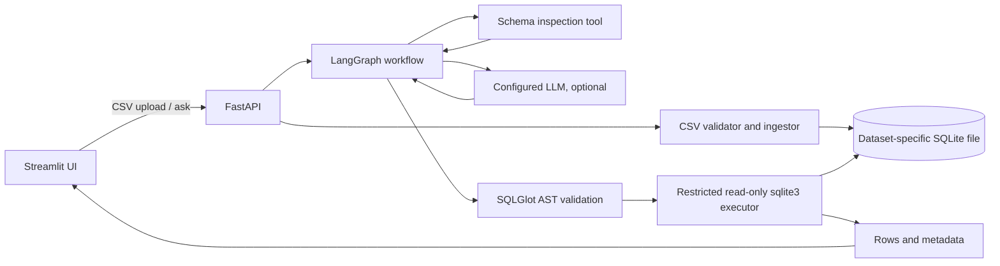

# SQLInsights: Codex Build Specification and Execution Plan

**Project name:** SQLInsights  
**Suggested GitHub repository:** `sqlinsights`  
**Project category:** Agentic AI / Natural-Language-to-SQL / Applied Data Analytics  
**Version:** 1.0, October 2026  
**Target:** A polished, reproducible local MVP, designed to be built with Codex in approximately 2–3 focused days. This is a target, not a guaranteed delivery time.  
**Status:** Specification only. No application features or test results are claimed as complete.

---

## 1. The project in plain English

**SQLInsights lets a user ask questions about CSV data in normal English without writing SQL.**

A user opens a Streamlit dashboard, creates a dataset, and uploads one or more CSV files with shared key columns when joins are needed. For MVP, SQLInsights does not infer or enforce foreign-key relationships automatically; it exposes the schema and tests example joins against known keys. SQLInsights inspects the resulting database tables and columns. The user asks a question such as:

> Which five products generated the most revenue in September 2026?

In **AI mode**, a LangGraph workflow uses a configured LLM to propose a SQLite query for that question. A separate, deterministic security layer checks the SQL before it is allowed anywhere near the database. The application runs accepted queries on a read-only SQLite connection, returns the SQL and actual result rows, and optionally creates a chart. It never invents numerical answers.

**Example end-to-end flow:**

1. Upload `orders.csv`, `products.csv`, and `customers.csv` into the same dataset.
2. SQLInsights generates safe table names, checks the CSVs, and saves their rows in SQLite.
3. Ask, “What were the top 5 products by revenue?”
4. The agent reads only the schema metadata needed to formulate SQL.
5. The validator blocks unsafe or unsupported SQL, then the query executor runs only permitted read operations.
6. The UI displays generated SQL, returned rows, a suitable bar chart, an execution summary, and any warning (for example, truncation or no results).

**Why it is useful:** It demonstrates an LLM integrated with real tools, database querying, API development, UI development, input handling, defensive execution, testing, and evaluation. It is much stronger for an AI/ML engineering portfolio than a notebook showing only model outputs.

**Do not call it a production-secure multi-tenant SaaS or a fully autonomous data scientist.** It is an intentionally scoped, local-first, single-user portfolio application.

## 2. Business goal, target users, and honest positioning

**Primary user:** A small-business analyst who has sales or operations CSV files and wants quick answers.

**Problem solved:** Non-technical users cannot easily write joins, aggregations, and filters. SQLInsights turns simple English questions into *reviewable SQL* and runs that SQL under enforced restrictions.

**Your portfolio message:**

> SQLInsights is a natural-language analytics assistant built with LangGraph, FastAPI, SQLite, Streamlit, and Plotly. It converts user questions into validated, read-only SQL and provides reproducible results and visualizations.

Use this as a description **only after the listed features actually work**. Publish measured evaluation results only after running tests. Until then, describe the repository as “in development.”

## 3. Scope: build the small, impressive version

### Must-have MVP (P0)

- Streamlit UI with dataset selection, CSV upload, schema preview, question input, generated SQL, table output, and chart.
- Preloaded **synthetic retail demo dataset** with three related tables and 25 answerable evaluation questions.
- Ability to create a local dataset and upload up to three CSV files, one table per file.
- FastAPI backend with typed request/response schemas and descriptive errors.
- LangGraph workflow with a real LLM integration when credentials are configured.
- Honest **offline demo mode** with a small library of predefined example questions, no key required; explicitly label it **Demo mode (predefined questions)**, never pretend it is general AI.
- Deterministic SQL security and read-only database execution.
- Bounded retries, timeouts, logging without dataset values, and graceful failures.
- Pytest unit/integration tests, API smoke tests, and a small evaluation runner.
- Docker Compose for reproducible **local-only** execution.
- Good README, architecture diagram, screenshots from the actual app, limitations, and license.

### Nice-to-have (P1, only after MVP passes)

- Ask follow-up questions (with a strictly bounded conversation context).
- Improve chart suggestions and downloadable PNG charts.
- Persist evaluation history to a local JSON file without storing raw sensitive data.
- Add one optional second provider model.

### Explicitly out of scope

- Arbitrary external databases (PostgreSQL, Snowflake, MySQL, BigQuery, etc.).
- Cloud deployment, authentication, multi-user tenants, sharing, payments, or production hardening.
- Executing generated Python, shell commands, arbitrary URLs, plugins, or user-supplied SQL scripts.
- Writes requested through natural language (INSERT, UPDATE, DELETE, CREATE, DROP, etc.).
- Browser automation, web research, vector databases, RAG, or a swarm of multiple agents.
- Marketing claims such as “100% secure,” “production ready,” or “99% accuracy” without evidence.

**Scope lock:** If a change is not necessary to meet a P0 acceptance criterion, defer it to a `BACKLOG.md` note. Do not turn this project into an enterprise analytics platform.

## 4. Recommended stack and rationale

| Layer | Use | Reason |
|---|---|---|
| Python | 3.12, unless compatibility tests prove a newer version | Well-supported ecosystem |
| FastAPI + Pydantic | Backend API and validation | Clear endpoints, schema generation, testability |
| LangGraph | Explicit bounded agent workflow | Visible tool steps, no uncontrolled loop |
| LangChain OpenAI integration | Optional provider for actual NL-to-SQL | Keep model behind an interface; use a configured model |
| SQLite + built-in `sqlite3` | Local data and query execution | Simple, portable, supports read-only connections, authorizers, progress handlers |
| SQLAlchemy | Controlled **ingestion** code only, if useful | Ergonomic table creation; never use it to bypass the secure query executor |
| SQLGlot | Parse and inspect generated SQLite SQL | Enforce AST-level constraints; not a complete security boundary by itself |
| pandas + stdlib `csv` | CSV inspection/ingestion and result formatting | Fast implementation with proper input checks |
| Streamlit + Plotly | UI, data tables, plots | Fast, interactive portfolio demo |
| pytest + httpx | Unit and API tests | Works offline with fake LLM responses |
| Ruff | Formatting/linting | Simple CI quality gate |
| uv + `uv.lock` | Dependency management | Reproducible installs; pin resolved versions in lockfile |
| Docker Compose | Backend/UI local orchestration | Reproducible run/demo |

**Implementation constraints:** Check current official documentation before choosing specific library APIs or models; pin *compatible tested versions* via `uv.lock`. Do not copy outdated LangChain/LangGraph examples blindly. No real provider calls are required in CI.

## 5. User journeys and expected behavior

### Journey A: No API key, runnable immediately

1. `docker compose up --build` (or local `uv` commands) starts the app.
2. UI clearly displays **Demo mode (predefined questions)**.
3. Synthetic retail sample loads from a documented seed step. No external dataset download is required.
4. User clicks one of at least **8 supported sample questions**.
5. A deterministic, pre-verified SQL template runs through **the same SQL validator and read-only executor** used in AI mode.
6. Actual rows and charts render. An unsupported free-form question is rejected politely, not answered with a fabricated query.

### Journey B: Real AI mode

1. User sets `AI_MODE=llm` and supplies their own provider key/model in `.env`.
2. User selects a dataset and asks a new supported analytical question.
3. Agent requests/receives schema metadata, generates proposed SQLite SQL, and sends it to the validator/executor.
4. Result appears with generated SQL, table, optional chart, execution metadata, and clear errors.
5. If a model call fails or credentials are absent, show a truthful provider error; **never silently substitute predefined example results**.

### Journey C: Upload CSV

1. User creates a dataset with a display name.
2. User uploads one or more CSVs (maximum three tables per dataset).
3. Backend validates the file size, encoding, headers, row shape, and column types, then ingests to a dataset-specific SQLite database.
4. UI shows table names, columns, inferred types, row counts, and a short preview.
5. User can ask questions about those tables in AI mode.
6. User can delete a dataset after confirmation; only that dataset's app-owned files may be deleted.

## 6. Architecture and trust boundaries



**Never let the LLM operate a database connection directly.** The model proposes SQL text; the non-LLM validator/executor makes the decision to run or reject it.

### Component contracts

- **Frontend (`frontend/`)**: Uses HTTP to the API. It must not open SQLite files or hold provider secrets.
- **API (`backend/app/api/`)**: Validates requests, owns dataset IDs, returns typed JSON, maps internal exceptions to safe public errors.
- **Ingestion (`backend/app/services/ingestion.py`)**: Validates CSV content; generates safe table names/column names; writes only through trusted app code.
- **Metadata (`backend/app/services/schema.py`)**: Returns a bounded list of allowed tables and columns. Avoid sending raw data rows to the LLM.
- **Agent (`backend/app/agent/`)**: Receives question + schema, produces one SQL candidate, and may retry once for a normal execution error.
- **SQL policy (`backend/app/services/sql_policy.py`)**: Pure, deterministic SQL parsing and rejection rules. No model calls.
- **Query executor (`backend/app/services/query_executor.py`)**: Opens database *read-only*, applies SQLite authorizer/progress handler, fetches only bounded results.
- **Presentation (`backend/app/services/result_format.py`)**: Produces chart metadata using deterministic rules and clear answers from actual returned rows.

## 7. Agent workflow: bounded and explainable

Use a small `StateGraph`, not an open-ended autonomous loop:

1. `load_schema`: trusted tool retrieves table/column metadata for the chosen dataset.
2. `plan_sql`: real LLM receives the question and schema, returns a **structured** object containing `sql` and optional `explanation_of_query` (not hidden reasoning). Demo mode retrieves approved examples.
3. `validate_sql`: deterministic SQLGlot policy rejects unsupported/mutating queries before SQLite execution.
4. `execute_sql`: trusted tool runs a bounded read-only query and returns real result rows.
5. `format_result`: deterministic answer and Plotly-compatible chart recommendation; never invent aggregates or values.
6. `finish`: respond with rows, SQL, mode, warnings, execution time and attempt count.

**Retry rule:** At most **one regeneration** after an ordinary parse/SQLite syntax error. Do not retry a security rejection, missing dataset, timeout, access denial, invalid upload, or provider authentication failure. Every path ends with a bounded success/error response. Set an explicit graph recursion limit and an LLM-call cap of two per question.

**Prompt rule:** Give the LLM only the selected dataset's approved schema metadata and the user's question. Instruct it to produce SQLite-compatible read-only analytical queries with known table names. Treat all user text, CSV headers, CSV cell values and model output as untrusted. Any prompt-injection attempt must still be blocked by the deterministic enforcement layer.

**Realism:** This is a **tool-using, graph-orchestrated text-to-SQL assistant**, not a multi-agent autonomous system. If no LLM is configured, call it a deterministic demo, not AI-driven SQL generation.

## 8. Security requirements: non-negotiable P0

Generated SQL is untrusted even if the language model labels it safe. Use **multiple independent restrictions**, because no regex or parser alone is a complete defense.

### A. SQL parser and allowlist

- Use `sqlglot.parse(..., read="sqlite")`, not a regex-only approach.
- Require exactly **one** parsed statement. Reject empty, multiple, malformed, or unsupported statements.
- MVP allows a query rooted in `SELECT` (including normal `WITH` CTEs only when every subquery is demonstrably read-only). If CTE validation is uncertain, reject CTEs for MVP and document that limitation. Reject unions/compound queries unless explicitly tested and validated.
- Walk the parsed expression tree and **reject** mutations, DDL, `PRAGMA`, `ATTACH`, `DETACH`, `EXPLAIN`, commands, virtual-table/table-valued function sources, file access functions, and anything not explicitly approved.
- Forbid cross-database references, SQLite internal tables (`sqlite_master`, `sqlite_schema`, etc.), and any table not in the selected dataset's allowlist. Correctly distinguish CTE aliases from physical tables if CTEs are supported.
- Allow only approved built-in scalar/aggregate functions needed for the MVP, such as `COUNT`, `SUM`, `AVG`, `MIN`, `MAX`, `ROUND`, `LOWER`, `UPPER`, `COALESCE` and approved date functions. Explicitly reject `load_extension`, `readfile`, `writefile`, unknown functions, and dangerous or platform-specific functions.
- Re-serialize the approved AST to SQLite SQL. Any ambiguity means **reject**, not guess.
- Do not take the LLM's own confidence or claimed safety as authorization.

### B. Restricted SQLite connection

- Query on a **separate** `sqlite3` connection opened with a correctly constructed, app-controlled `file:` URI and `mode=ro` (test the URI/path encoding). Never build the URI from user-supplied paths.
- Apply `PRAGMA query_only=ON` as an additional restriction. The query-only pragma is not by itself a complete read-only sandbox.
- Install a `sqlite3.Connection.set_authorizer(...)` callback and deny anything beyond required SELECT, READ of approved dataset tables, and explicitly allowlisted built-in functions. Deny attach/detach, pragmas from user SQL, writes, schema changes, temp tables, and extension loading. Confirm exact callback actions against the Python/SQLite version actually installed.
- Install a `set_progress_handler(...)` with a `time.monotonic()` deadline (target 5 seconds), so expensive queries can be interrupted. Also set a short SQLite lock timeout, and enforce SQL length limits.
- Use a **fresh connection per query**, close it on success or error, and do not pass it to arbitrary agent code.
- Cap returned rows to **200**. Fetch `MAX_ROWS + 1` to determine a truthful `truncated` flag; use a bounded outer SELECT where safe, and separately cap execution time for expensive aggregation queries.
- Do not assume `LIMIT` alone prevents expensive queries. Timeout/progress-handler limits are mandatory.
- Never interpolate an untrusted SQL expression, identifier, file path, or condition into trusted ingestion queries. Use quoted sanitized identifiers and parameters for values.
- Run locally with least-privileged processes and app-owned dataset files. Do not expose the demo API publicly by default.

### C. Input and upload handling

- Accept only `.csv` in MVP; verify actual parseable CSV content, not just extension/MIME type.
- Server-enforced per-file limit **5 MiB**, at most **3 tables/dataset**, at most **40 columns/table** and **50,000 rows/table**. Streamlit upload limits do not replace API enforcement.
- Support UTF-8 including UTF-8 BOM; reject unsupported encodings clearly instead of silently corrupting text.
- Reject empty files, missing/duplicate headers after normalization, malformed row widths, oversized cells, and files containing invalid content. Define and test a reasonable cell-size cap (e.g., 20,000 characters).
- Preserve leading-zero identifiers (postal codes/order IDs) as text; avoid irreversible dtype inference. Use conservative types (`TEXT`, `INTEGER`, `REAL`) with consistent null handling. Document that dates are ISO-formatted text for MVP.
- Normalize table and column identifiers deterministically; use safe generated names, retain the original display label as metadata, and never use uploaded filenames as filesystem paths.
- Dataset IDs must be random UUIDs mapped to app-owned local paths. Prevent `../`, symlink escapes, and cross-dataset access. Only delete paths confirmed to be inside the data root.
- Never run arbitrary code, macros, formula evaluation, or SQL from the CSV content.

### D. Secrets, privacy, API and deployment

- Keep provider keys only on the backend via `.env`, never in Streamlit, Git history, or API responses.
- The **LLM mode sends the user's question and approved schema (including column names) to the selected provider**. Make this clear in the README/UI. Do not send entire uploaded row sets or result tables to the external LLM.
- Raw questions, SQL literals, uploaded rows, and API keys must not be logged. Log only sanitized event type, request ID, mode, duration, row count, error category, and coarse counters.
- Restrict the default API/UI to `127.0.0.1` when running on the host; Docker Compose host mappings must bind to loopback. No permissive CORS or publicly exposed port by default.
- MVP has **no auth**, so it is **not suitable for public internet deployment**. The README must say this prominently.
- Store uploaded datasets only locally, in ignored files; provide a clear delete operation and explain there is no database-at-rest encryption in this MVP.
- Before public GitHub upload, verify no `.env`, keys, DB files, customer files, logs with values, or private records are committed.

### E. Required adversarial test cases

Reject or safely handle:

```sql
DROP TABLE orders;
SELECT * FROM orders; DELETE FROM orders;
PRAGMA database_list;
ATTACH DATABASE '/tmp/other.db' AS other;
UPDATE orders SET total = 0;
SELECT * FROM sqlite_master;
SELECT load_extension('x');
SELECT readfile('/etc/passwd');
SELECT * FROM (SELECT * FROM orders) WHERE 1=1;
```

The last case is deliberately **safe** when it only touches approved tables; test that the validator accepts safe subqueries while rejecting the unsafe ones. Also test a very expensive cross join to verify timeout handling, and SQL generated from a prompt-injection style question asking to disable safeguards.

## 9. API contract (stable MVP)

All responses are JSON except the multipart upload route. API prefix: `/api/v1`.

| Method | Route | Purpose |
|---|---|---|
| `GET` | `/health` | Return app readiness and current execution mode (no secrets) |
| `GET` | `/api/v1/datasets` | List local dataset IDs, display names and table counts |
| `POST` | `/api/v1/datasets` | Create empty dataset from `{ "name": "Retail Demo Copy" }` |
| `POST` | `/api/v1/datasets/{dataset_id}/tables` | Upload one multipart CSV with field `file` |
| `GET` | `/api/v1/datasets/{dataset_id}/schema` | Allowed tables, columns, inferred types and counts |
| `GET` | `/api/v1/datasets/{dataset_id}/preview?table=orders&limit=10` | Limited preview for selected allowed table |
| `POST` | `/api/v1/ask` | Ask natural-language question against selected dataset |
| `DELETE` | `/api/v1/datasets/{dataset_id}` | Delete selected app-owned dataset after frontend confirmation |

**Ask request:**

```json
{
  "dataset_id": "<uuid-or-preloaded-demo-id>",
  "question": "What are the top five products by revenue?"
}
```

**Ask success response shape:** (illustrative contract example on hypothetical synthetic rows, **not an actual executed result or benchmark**)

```json
{
  "status": "success",
  "mode": "llm",
  "answer": "The query returned 2 order rows.",
  "sql": "SELECT order_id, quantity FROM orders ORDER BY quantity DESC LIMIT 2",
  "columns": ["order_id", "quantity"],
  "rows": [["O-001", 3], ["O-002", 2]],
  "row_count_returned": 2,
  "truncated": false,
  "chart": { "type": "bar", "x": "order_id", "y": "quantity" },
  "attempts": 1,
  "elapsed_ms": 42,
  "warnings": []
}
```

These values are **only illustrative synthetic example values**, not measured application output. The implementation must populate `rows`, `row_count_returned`, `answer`, `elapsed_ms`, and chart selection based on the **actual executed query**. In tests assert `row_count_returned == len(rows)`; ensure `answer` and `chart` accurately reflect the rows. Prefer a separate `status: "empty"` response for zero rows. For a rejected query use a documented, typed error response, not `status: success`. In README, replace this example with the actual observed output.

**Standard error response:**

```json
{
  "status": "error",
  "error": {
    "code": "SQL_POLICY_DENIED",
    "message": "The proposed query is not allowed in read-only mode.",
    "request_id": "<request-id>"
  }
}
```

**HTTP behavior:** 400 for invalid question, 404 for unknown dataset/table, 413 for oversize upload, 415 for unsupported file type, 422 for malformed CSV/unsafe SQL, 503 for configured provider unavailable or key missing, 504 for query deadline exceeded. Never leak stack traces or file paths to clients.

## 10. Data model and seeded sample

- **Dataset:** UUID, display name, internal DB path, creation timestamp, table metadata. The preloaded demo uses a stable internal ID such as `retail_demo` and cannot be deleted accidentally.
- **Table:** sanitized internal table name, original filename/display label, columns, row count, inferred types.
- **File storage:** `data/datasets/<dataset_id>.db`, ignored by Git. Maintain small app-owned JSON metadata under `data/`; do not permit clients to provide these paths.
- **Demo seed:** three *synthetic* CSVs in `sample_data/`, committed to Git because they contain no real identities or secrets:
  - `customers.csv`: `customer_id`, `city`, `segment`.
  - `products.csv`: `product_id`, `category`, `product_name`.
  - `orders.csv`: `order_id`, `customer_id`, `product_id`, `order_date`, `quantity`, `unit_price`.
- Choose clear units. For example, `quantity` is a nonnegative integer, `unit_price` is a nonnegative EUR amount, and `order_date` is ISO `YYYY-MM-DD` text. If sales returns/discounts are excluded, document it. For this portfolio demo, `REAL`-based calculations may show floating-point rounding; round display to two decimal places and use numeric tolerances in reference tests. Do not imply bank-grade financial arithmetic.
- Use stable generation seeds and save the sample CSVs to the repo. Do **not** fabricate real customers or claim business results are real.
- Provide 8 example prompts in the UI, including an aggregation, date filter, top-N ranking, grouped comparison, two-table join, and three-table join.

### Required evaluation fixture

Commit `evaluation/questions.jsonl` with **25** synthetic-dataset questions. Each entry contains: ID, question, expected answer checks (e.g. expected scalar value/row set), needed tables, and category. Keep expected values derived and verified by independent hand-authored reference SQL; do not have the same LLM produce both candidate and expected answer.

## 11. Answer and chart behavior

- Always show the **actual SQL executed** (after canonicalization/row-limit wrapper as appropriate), never only the raw model suggestion.
- Tables contain actual DB results, not LLM-generated sample rows.
- For 2-column category + number results, default to a bar chart.
- For date + number, default to a line chart if ISO date parsing succeeds.
- For unsuitable/high-dimensional data, show a table and a clear “Chart unavailable for this result” message.
- For zero matching rows, display “No rows matched the query,” not a fabricated analysis.
- For aggregates, do not write a precise summary from a truncated or incomplete result if it cannot be derived reliably.
- For a query that times out or fails policy checks, do not display cached results as if the query succeeded.
- Streamlit caches only immutable schema/sample assets as needed; do not cache answers across dataset IDs or across changed uploads without invalidation.

## 12. Suggested repository structure

```text
sqlinsights/
├── AGENTS.md
├── SQLINSIGHTS_BUILD_PLAN.md
├── README.md
├── LICENSE
├── .gitignore
├── .env.example
├── pyproject.toml
├── uv.lock                     # created by Codex after dependency resolution
├── Dockerfile.api
├── Dockerfile.ui
├── docker-compose.yml
├── backend/
│   └── app/
│       ├── main.py
│       ├── config.py
│       ├── api/
│       │   ├── datasets.py
│       │   └── ask.py
│       ├── agent/
│       │   ├── graph.py
│       │   ├── models.py
│       │   └── prompts.py
│       ├── services/
│       │   ├── ingestion.py
│       │   ├── dataset_store.py
│       │   ├── schema.py
│       │   ├── sql_policy.py
│       │   ├── query_executor.py
│       │   └── result_format.py
│       └── schemas.py
├── frontend/
│   └── app.py
├── sample_data/
│   ├── customers.csv
│   ├── products.csv
│   └── orders.csv
├── evaluation/
│   ├── questions.jsonl
│   └── run_eval.py
├── scripts/
│   └── seed_demo.py
├── tests/
│   ├── test_ingestion.py
│   ├── test_sql_policy.py
│   ├── test_query_executor.py
│   ├── test_api.py
│   ├── test_agent.py
│   └── test_evaluation.py
├── docs/
│   ├── architecture.md
│   └── screenshots/           # real screenshots, after running UI
└── .github/
    └── workflows/
        └── ci.yml
```

Use Python package imports consistently. Simplify this structure if needed, but **do not collapse SQL validation into prompt text** and do not hide all logic in `app.py`.

## 13. Implementation milestones: stop at each quality gate

### Phase 0: Repository bootstrap (1–2 hours target)

**Build:** project skeleton, `pyproject.toml`, tested dependency lockfile, `.gitignore`, `.env.example`, API health route, Streamlit landing page, initial README, CI stub.

**Done when:**

- [ ] Clean environment installs with locked dependencies.
- [ ] `uv run pytest -q` succeeds for initial smoke tests.
- [ ] `uv run ruff check .` succeeds.
- [ ] API `/health` responds and Streamlit starts locally.
- [ ] `.env` and `data/` are ignored; no secrets in source.

**Stop and fix failures before phase 1.**

### Phase 1: Synthetic data + ingestion + dataset APIs (3–5 hours target)

**Build:** seed data, dataset CRUD, CSV validation, header/type inference, schema listing, previews, UI upload.

**Done when:**

- [ ] Demo data reproducibly creates three related tables.
- [ ] Single and multiple CSV uploads work in a selected dataset.
- [ ] Headers with spaces/special characters are handled and mapped safely.
- [ ] Wrong delimiters, invalid encoding, oversized/empty CSV, duplicate headers, and malformed rows return safe errors.
- [ ] Leading-zero identifiers remain correct.
- [ ] Dataset deletion cannot remove unrelated files.
- [ ] API tests pass with temporary data directories.

### Phase 2: SQL policy and executor FIRST (3–5 hours target)

**Build:** independent validator, read-only SQLite connection, authorizer, progress handler, row limit, result serialization, adversarial tests.

**Done when:**

- [ ] Approved SELECT queries run, including joins, aggregates, filters, grouping, sorting, and subqueries.
- [ ] Every forbidden SQL example in section 8 is rejected before execution.
- [ ] Database checksum/row counts do not change after attempted writes.
- [ ] SQL table references cannot escape the selected dataset.
- [ ] Expensive-query timeout test interrupts execution.
- [ ] Large-result test caps output to 200 and reports truncation truthfully.
- [ ] Security tests run offline and pass.

**Important:** Do not connect an LLM until these checks are green.

### Phase 3: LangGraph + real AI mode + demo mode (3–5 hours target)

**Build:** typed graph state, schema tool, provider interface, SQL proposal, one safe retry, API `/ask`, demo example registry, deterministic result formatter.

**Done when:**

- [ ] Real mode uses the LLM for novel questions (with a configured key).
- [ ] Demo mode only supports declared examples; unsupported questions are not pretended to work.
- [ ] Both modes pass through the identical policy/executor.
- [ ] Stubbed model test produces valid SQL and returns actual DB rows.
- [ ] Stubbed model returning malicious SQL is denied and cannot change DB state.
- [ ] Provider timeout, bad key, and malformed model output fail clearly.
- [ ] At most two generation attempts; no infinite loops.

### Phase 4: Dashboard and visualization (2–4 hours target)

**Build:** simple Streamlit layout, upload/schema preview, query UI, sample buttons, SQL expander, table, chart, warnings, mode label.

**Done when:**

- [ ] A new user can understand what the tool does without reading code.
- [ ] The local demo works without an API key.
- [ ] Chart and results reflect the returned DB data.
- [ ] A rejected query shows a helpful message, not a traceback.
- [ ] A refresh does not accidentally create duplicate tables.

### Phase 5: Tests, evaluation, Docker, CV polish (3–5 hours target)

**Build:** 25-question evaluation fixture, evaluation runner, Dockerfiles/Compose, README with screenshots, CI.

**Done when:**

- [ ] `uv run ruff check .` passes.
- [ ] `uv run pytest -q` passes with no network or API keys.
- [ ] `uv run python evaluation/run_eval.py --mode demo` runs and reports exactly what was tested. Demo-mode score is **not** presented as LLM accuracy.
- [ ] Optional manual real-provider evaluation explicitly separates `llm` metrics from demo/mock metrics.
- [ ] `docker compose up --build` starts local API and UI; no cloud required.
- [ ] The README contains verified setup commands, actual test results, real screenshots, and known limitations.
- [ ] Repository contains no secrets, SQLite data files, user uploads, or fake performance claims.

**Fallback if time runs short:** Finish phases 0–4 well, document phase 5 gaps honestly, and do not advertise untested claims on your CV.

## 14. Test and evaluation plan

### Offline tests required in CI

1. CSV normal import, multi-file import, and repeat upload behavior.
2. Empty CSV, invalid UTF-8, BOM, bad delimiter, duplicate columns, malformed row widths, too many rows/columns, excessive file size, weird filename, oversized cell.
3. Type inference with missing values, numeric quantities, ISO dates, leading-zero IDs.
4. Dataset isolation, invalid UUID, path traversal attempts, deletion safety.
5. Valid SELECT, CTE policy (supported or explicitly rejected), subquery, JOIN, aggregate, LIMIT, group, date filters.
6. Unsafe SQL (write, DDL, PRAGMA, ATTACH, multiple statements, internal tables, file functions, unknown function).
7. Read-only connection enforcement (including direct executor bypass attempts).
8. Row cap, truncation flag, query timeout, error mapping, no stale result reuse.
9. Agent valid SQL, invalid SQL, bad provider output, one retry, blocked security query, missing provider key.
10. API happy paths, error status codes, response model validation, health route, upload bytes limit.
11. Demo mode only runs declared examples; LLM mode uses actual provider interface (fake it in offline tests).
12. Evaluation runner validates fixture structure and reports pass/fail correctly.

### Evaluation metrics (report actual observed numbers only)

- **Execution success rate:** fraction of evaluated questions producing a successful query.
- **Answer correctness:** fraction whose returned results match reference checks for the fixed synthetic data.
- **Unsafe-query blocking:** count blocked out of a published, fixed malicious-query suite; do not infer universal protection from it.
- **Latency:** median and p95 per question; note machine/model/provider used.
- **Token/cost:** only if the provider reports usage; otherwise mark unavailable.

Make a small table in README distinguishing **offline tests** from **real LLM evaluation**. If the provider evaluation has not been run, write **Not evaluated**. Do not print made-up 95%+ scores.

## 15. Environment and startup contracts

Required `.env.example` keys:

```dotenv
AI_MODE=demo
OPENAI_API_KEY=
OPENAI_MODEL=
DATA_DIR=./data
MAX_UPLOAD_MB=5
MAX_RESULT_ROWS=200
QUERY_TIMEOUT_SECONDS=5
API_BASE_URL=http://localhost:8000
```

- `AI_MODE=demo` must start without a key. `AI_MODE=llm` requires a valid model and provider key; otherwise fail clearly.
- `OPENAI_MODEL` is intentionally blank in the template; select a currently available compatible model when configuring AI mode. Do not silently invent a fallback model.
- Streamlit should use `API_BASE_URL` from its environment. Inside Docker Compose, set it to `http://api:8000`; from the host, use `http://localhost:8000`.
- Add helpful scripts documented in README: `uv sync --locked`, `uv run pytest -q`, `uv run ruff check .`, `uv run uvicorn backend.app.main:app --reload`, `uv run streamlit run frontend/app.py`, `docker compose up --build`.
- Bind exposed Compose host ports to `127.0.0.1:8000` and `127.0.0.1:8501`. Persist app data in a local mounted directory.
- The actual commands must be revised if the final package layout differs; run them instead of assuming they work.

## 16. README and demo requirements

The final README must have these sections, using verified information:

1. **What SQLInsights does** (2–3 sentences and a real screenshot).
2. **Architecture** and trust boundary, including SQL validation and execution restrictions.
3. **Features and non-features**, with demo mode vs real AI mode clearly separated.
4. **Quick start**, no-key local demo first; optional LLM setup second.
5. **Five-minute walkthrough**, including upload and a successful question.
6. **Example questions** and sample CSV schema.
7. **API endpoints** and an example request/response from a working run.
8. **Evaluation** with exact commands and real observed outcomes; date, dataset and model used.
9. **Security and privacy** limitations (no auth, single-user, local-only, provider receives question/schema).
10. **Known limitations / future work**, without overstated claims.
11. **Tech stack**, license, and how to reproduce tests.

### Demo acceptance scenario

- Open `http://localhost:8501`.
- Select `Retail Demo` (synthetic).
- Click “Top 5 products by revenue.”
- See a SQL query, correct result table and bar chart.
- Upload a new `sales.csv`, ask a compatible custom question in LLM mode, see actual results.
- Try asking “Delete all rows from orders.” See a rejection and unchanged DB.
- Show the `pytest` output and GitHub CI status.

Do not record a demo video or screenshot until the app actually runs. Never show mocked performance as a production result.

## 17. Definition of done: release gate

Call the project **portfolio-ready** only when **all** are true:

- [ ] API, UI, demo data, and CSV upload work from a clean installation.
- [ ] Real LLM mode works with a configured key; if not, disclose its unverified status and do not claim it in CV.
- [ ] SQL generation is separate from enforced read-only execution.
- [ ] All dangerous cases in section 8 are blocked, and read-only data integrity checks pass.
- [ ] Resource limits and error handling work, including timeouts and result truncation.
- [ ] Tests, lint, CI and Docker start checks were actually run and passed.
- [ ] The synthetic fixture and reference checks are reproducible.
- [ ] README has accurate architecture, limitations, instructions, screenshots and measured results.
- [ ] No private data or credentials in Git.
- [ ] You can explain the graph, SQL safety layers, one limitation, and how you evaluated it in a 3-minute interview.

**Reality check:** No specification can guarantee zero bugs or close every possible security loophole. The purpose of this plan is to constrain the build, test common failures, and make unresolved risks visible. Do not expose the unauthenticated MVP to the public internet.

## 18. CV bullets (use ONLY when verified)

Possible English bullets after finishing the corresponding features:

- Built **SQLInsights**, a natural-language SQL analytics application with **LangGraph, FastAPI, SQLite and Streamlit**, turning English questions into reviewable SQL and interactive visualizations.
- Implemented **layered read-only SQL execution** using AST validation, SQLite authorizer restrictions, query timeouts, and bounded result sets.
- Developed a **reproducible evaluation suite** with 25 analytical questions, automated tests, and documented results on synthetic retail data.

If real-mode evaluation is performed, add its *actual* result and conditions. Otherwise do not claim model accuracy.

Possible German bullet after successful completion:

> Entwicklung von **SQLInsights**, einem KI-gestützten Natural-Language-to-SQL-Tool mit LangGraph, FastAPI, SQLite und Streamlit; Implementierung validierter Read-only-Abfragen, automatisierter Tests und interaktiver Datenvisualisierungen.

## 19. Codex execution instructions (follow literally)

1. Read `AGENTS.md` and **all of this file** first.
2. Inspect the working directory before writing files. If existing application code is present, preserve it and propose only necessary changes. Do not delete unrelated work.
3. Work in the phase order of section 13. Build one milestone at a time. If test failures arise, fix them before continuing.
4. Follow the scope lock; no OAuth, cloud deployment, extra tools/agents, RAG, or unsupported features.
5. Use official documentation for APIs that may have changed; generate a lockfile with tested versions.
6. Build secure SQL ingestion/execution **before** LLM integration.
7. Run offline tests, lint, API smoke checks, and Docker checks where available. Do not claim commands passed unless their output confirms it.
8. Track blockers, assumptions, and skipped checks in a concise `BUILD_STATUS.md`. Update it only with actual observed evidence.
9. Never place credentials in files, commits, examples, or logs. Ask the user for credentials only when they are needed for the optional real-model test; do not block no-key demo development.
10. Keep code clear enough for a developer to explain. Prefer small modules, type annotations, and sensible docstrings over overengineering.
11. Stop if a security acceptance criterion cannot be met. Report the precise limitation instead of silently weakening protections.
12. Do not commit, push, or deploy without an explicit user request.

### First prompt to paste into Codex

```text
You are building SQLInsights, a local-first natural-language-to-SQL analytics portfolio app.

Read AGENTS.md and SQLINSIGHTS_BUILD_PLAN.md in full. Treat the plan as the source of truth for MVP behavior, scope, trust boundaries, milestones, tests, and definition of done.

First, inspect the repository and summarize any existing files or conflicts. Then implement Phase 0 and Phase 1 only, without adding features from later phases. Make the synthetic dataset reproducible and ensure the upload/schema API works. Run the stated quality checks, fix failures, and update BUILD_STATUS.md with commands actually run, outcomes, and remaining blockers.

Do not push or deploy. Do not fabricate tests or metrics. When Phase 0–1 acceptance criteria pass, stop and report how to launch the local app and the next phase to run.
```

### Prompt for subsequent phases

```text
Read AGENTS.md, SQLINSIGHTS_BUILD_PLAN.md, BUILD_STATUS.md, and the current source code. Implement ONLY Phase <NUMBER> from section 13. Respect the security requirements and existing public API contract. Add/repair tests for that phase. Run applicable checks, document actual results and open issues in BUILD_STATUS.md, and stop. Do not proceed to the next phase, push or deploy without my direction.
```

**Recommendation:** Start with Phase 0–1, then Phase 2, then Phase 3, then Phase 4–5. This produces verifiable checkpoints instead of a single enormous Codex request.

## 20. Official references to verify while implementing

- Codex repository instructions and execution workflow: https://developers.openai.com/cookbook/examples/codex/iterating-development-workflows-with-codex
- LangGraph quickstart: https://docs.langchain.com/oss/python/langgraph/quickstart
- LangGraph overview: https://docs.langchain.com/oss/python/langgraph/overview
- Python SQLite connection, authorizer, progress handler: https://docs.python.org/3/library/sqlite3.html
- SQLite `query_only` behavior: https://www.sqlite.org/pragma.html#pragma_query_only
- SQLGlot parser/AST reference: https://sqlglot.com/sqlglot.html
- FastAPI CSV file upload patterns: https://fastapi.tiangolo.com/tutorial/request-files/
- Streamlit file uploader and limits: https://docs.streamlit.io/develop/api-reference/widgets/st.file_uploader

**Source-of-truth rule:** When documentation and this plan differ on a library signature, use the current official docs, update the implementation consistently, and note the change in `BUILD_STATUS.md`. Never remove a security requirement just to make a demo appear to work.
